<div align="center">
  <picture>
    <source media="(prefers-color-scheme: dark)" srcset="assets/banner-dark.png" />
    
  </picture>
  <h1>Hush</h1>
  <p><strong>You asked for a change. Read what changed.</strong></p>
</div>

<p align="center"><strong>Available on</strong></p>
<table align="center">
  <tr>
    <td align="center"><a href="#claude-code"><br />Claude Code, primary host</a></td>
    <td align="center"><br /><del>Codex</del></td>
    <td align="center"><br /><del>Antigravity</del></td>
  </tr>
</table>
<p align="center"><small>Hush has no Codex package and no Antigravity package.</small></p>

<p align="center"><a href="#install"><strong>Get started</strong></a> · <a href="#what-is-this">What is this?</a> · <a href="#how-it-works">How it works</a> · <a href="#what-you-can-do">What you can do</a> · <a href="#the-numbers">Evidence</a></p>

## What is this?

Hush is a plugin for Claude Code, an AI coding assistant. It runs on Claude Code only. It makes a session quieter to read.

You ask the assistant to fix a failing test. It reads files, runs commands and explains each step. When it finishes, the result is hard to find.

Hush quiets that narration and shortens noisy command output. Then it shapes the last message around three things: what changed, whether it worked, and what to do next.

<p align="center"></p>

*Ember is the mascot of the Foundry plugins. The scene is an illustration, not a measurement.*

**You ask:** "The login test fails. Fix it."

**You get:** one message at the end, shaped like this. It is the voice's own example, shortened. A recorded session is under [The numbers](#the-numbers).

```text
**The login test passes again. The token check compared text with a number.**

---

`verifyToken` read the expiry as text, so every token looked expired.
I changed one line, auth.js:58, to read it as a number.

`npm test` passes: 212 passed, 0 failed, 0 skipped.
I did not try a real login in the browser.

---

**Next:** open auth.js:58 and read the one-line change.
```

## Why you'd want it

- **The result comes first.** One bold line says what happened.
- **Less to scroll past.** Routine narration between steps goes quiet.
- **Long output stays out of the way.** A 300 KB log becomes a short digest, and the full copy stays on your machine.

## How it works

Hush has two parts. Both run on your machine, and nothing is sent anywhere.

| Part | What it does |
| --- | --- |
| The voice | An output style, which is Claude Code's name for a writing style. It asks the assistant to stay quiet while it works, then write one message at the end. |
| The trims | Hooks, which are small programs Claude Code runs at set moments. These run when a command finishes. They shorten long output and keep every warning, error and failure line. |

A shortened view says so in square brackets. Very large output is saved to a file, so the assistant can read the rest.

Read [how Hush works](docs/knowledge/how-it-works.md) for each trim, its limits and where saved output goes.

## What you can do

| You want to | What you get |
| --- | --- |
| Read the result first | Short, plain answers that open with the result |
| See output that was shortened | A reference to the saved full copy, where one exists |
| Change the message's layout | `/hush:config`, described under [Settings](#settings) |
| Get a long explanation | Ask for one. A request to explain lifts the length limit for that answer |
| Pause the voice for one session | Send `hush off`. Send `hush on` to bring it back |
| Turn off part of Hush | One environment variable per part, listed under [Settings](#settings) |
| Show how much Hush kept out | A count you can read from your own status line script; see [the saved count](docs/knowledge/how-it-works.md#the-saved-count) |

### Settings

Most people never change a setting. These three are the ones people reach for:

| Setting | Values | What it does |
| --- | --- | --- |
| `/hush:config` | A command | Shapes the last message: its length, its parts and where the next step goes. |
| `HUSH_DISABLE` | `1` | Stops the trims and the reminders. The voice stays on until you disable or uninstall the plugin. |
| `HUSH_WRAP` | `1` | Lets Hush trim the output of failing commands too. It is not safe with scoped allow rules such as `Bash(node*)`. |

No setting removes a blocker, a pending approval, an unverified claim or anything left unchecked.

[Hush settings](docs/knowledge/settings.md) lists every variable, preset and message setting.

## Install

### Claude Code

You need Claude Code 2.1.323 or later, and Node.js 22 or later.

Inside Claude Code, run:

```text
/plugin marketplace add V-Songbird/foundry
/plugin install hush@foundry
```

Then start a new session.

To check that it worked, run `claude plugin list` in a terminal. The list names `hush`. Then run `/hush:config` inside Claude Code: the configurator opens, or its questions start in a terminal.

Hush names Claude Code 2.1.323 in its manifest. An older Claude Code may still install it, and Hush is not tested there.

### Update

In Claude Code, run these. Then start a new session:

```text
/plugin marketplace update foundry
/plugin update hush@foundry
```

## Good to know

| Limit | What it means for you |
| --- | --- |
| A short answer can leave out a detail | Correctness comes before silence. Ask for depth when you need it, and check the result before you act on it. |
| Quieter is not always cheaper | On Claude Opus 5.5, Hush sessions cost 9% more on average. See [The numbers](#the-numbers). |
| The voice takes the one output style slot | To use another output style in Claude Code, disable or uninstall Hush. |
| Saved output is temporary | Hush deletes it when the session ends. On Windows, treat the saved files as readable by anything that runs as you. |
| The desktop mod is new | It is optional and draws only in the Claude desktop app's Code tab. No rendered check of it is published. |

## The numbers

Each figure comes from recorded test sessions. The figures describe those runs, not yours, and results vary between runs.

Each test session is a real Claude Code session in its own throwaway folder. Every job ends with a check, and a short answer that breaks the job counts as a failure.

### Claude Code results

This batch ran on September 28, 2026 with Claude Opus 5.5 at the default effort. It has nine jobs and four runs per setup, so 36 sessions each. It measures the voice released as [1.13.0](https://github.com/V-Songbird/hush/releases/tag/v1.13.0), not the current one.

<!-- foundry:evidence {"platform":"Claude","status":"measured","models":["Claude Opus 5.5"],"source":"docs/knowledge/benchmarks.md","date":"2026-09-28","reviewedAt":"2026-11-14"} -->
| Model | Setup | Jobs right | Spoke at most once before the answer | Median final prose words | Average bill per session |
| --- | --- | --- | --- | --- | --- |
| Claude Opus 5.5 | No plugin | 36/36 | 28/36 | 369 | $0.421 |
| Claude Opus 5.5 | hush | 36/36 | 36/36 | 271 | $0.458 |

<p align="center"></p>

Both setups got all 36 jobs right. Hush said nothing before the answer in 34 of 36 sessions, against 12 of 36 without a plugin. Its final answers were about 27% shorter.

**On Opus 5.5, Hush costs more.** The average bill per session was 9% higher. Seven of the nine jobs cost more, by 4% to 32%. Only the two jobs that print the most came out cheaper.

<details>
<summary>Watch the recorded demo: the same job with and without Hush, on Claude Opus 5.5</summary>

<p align="center"></p>

</details>

[Hush benchmarks](docs/knowledge/benchmarks.md) has every batch: the 40-word block rule, Claude Sonnet 5.5, the earlier voices, and where Hush loses.

## Going deeper

[How Hush works](docs/knowledge/how-it-works.md) · [Hush settings](docs/knowledge/settings.md) · [Hush benchmarks](docs/knowledge/benchmarks.md)

Release notes are on the [Hush releases page](https://github.com/V-Songbird/hush/releases). [Foundry](https://github.com/V-Songbird/foundry) lists the whole family.

Report a bug or ask a question on [Hush's issue tracker](https://github.com/V-Songbird/hush/issues). Report a vulnerability as [SECURITY.md](SECURITY.md) says. To change Hush, read [CONTRIBUTING.md](CONTRIBUTING.md).

## License

MIT, see [LICENSE](LICENSE).
