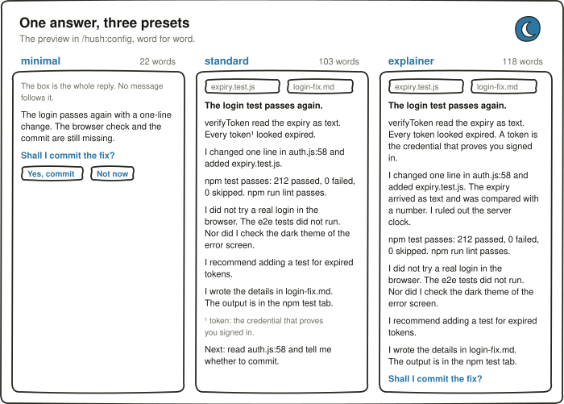
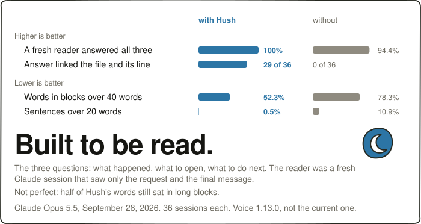

<div align="center">
  <picture>
    <source media="(prefers-color-scheme: dark)" srcset="assets/banner-dark.png" />
    
  </picture>
  <h1>Hush</h1>
  <p><strong>Every answer in the shape you choose.</strong></p>
</div>

<p align="center"><strong>Available on</strong></p>
<table align="center">
  <tr>
    <td align="center"><a href="#claude-code"><br />Claude Code, primary host</a></td>
    <td align="center"><br /><del>Codex</del></td>
    <td align="center"><br /><del>Antigravity</del></td>
  </tr>
</table>
<p align="center"><small>Hush has no Codex package and no Antigravity package.</small></p>

<p align="center"><a href="#install"><strong>Get started</strong></a> · <a href="#what-is-this">What is this?</a> · <a href="#how-it-works">How it works</a> · <a href="#what-you-can-do">What you can do</a> · <a href="#the-numbers">Evidence</a></p>

## What is this?

Hush is a plugin for Claude Code, an AI coding assistant. It runs on Claude Code only. It gives every answer the same shape, and you set that shape.

You ask the assistant to fix a failing test. It reads files, runs commands and explains each step. When it finishes, the result is somewhere in the scroll.

With Hush the steps fold away. One message comes at the end. It holds the same parts in the same order: what happened, why, what did not pass, and what to do next.

<p align="center"></p>

*Ember is the mascot of the Foundry plugins. The scene is an illustration, not a measurement.*

**You ask:** "The login test fails. Fix it."

**You get:** one message at the end, shaped like this. It is the voice's own example, shortened. A recorded session is under [The numbers](#the-numbers).

```text
**The login test passes again. The token check compared text with a number.**

---

`verifyToken` read the expiry as text, so every token looked expired.
I changed one line, auth.js:58, to read it as a number.

`npm test` passes: 212 passed, 0 failed, 0 skipped.
I did not try a real login in the browser.

---

**Next:** open auth.js:58 and read the one-line change.
```

## Why you'd want it

- **Yours to shape.** `/hush:config` sets the length, the parts and the layout. Pick a preset, or describe what you want in your own words.
- **Steps folded, not lost.** A 300 KB log becomes a short digest, and the full copy stays on your machine.
- **A shape you can count on.** The result comes first, in one bold line. Steps come numbered. Things with the same fields come as a table.
- **A floor no setting removes.** A blocker, a failed check and an unverified claim always stay.

## How it works

Hush has three parts. All run on your machine, and nothing is sent anywhere.

| Part | What it does |
| --- | --- |
| The voice | An output style, which is Claude Code's name for a writing style. It asks the assistant for one message at the end of the work. It gives each kind of content its form. |
| The trims | Hooks, which are small programs Claude Code runs at set moments. These run when a command finishes. They shorten long output and keep every warning, error and failure line. |
| The fold | An optional mod for the Claude desktop app. It folds a finished turn's progress texts into one line. One press shows them again. |

A shortened view says so in square brackets. Very large output is saved to a file, so the assistant can read the rest.

Read [how Hush works](docs/knowledge/how-it-works.md) for each trim, its limits and where saved output goes.

## What you can do

| You want to | What you get |
| --- | --- |
| Choose how much you read | `/hush:config` and one of four presets, from `minimal` to `explainer` |
| Set one part at a time | 14 settings: the length, the sentence length, where the next step goes, emoji cues and more |
| Describe it in your own words | `/hush:config only the result and the next step` |
| See your choice before you save it | A configurator with a sample message, in the Claude desktop app |
| See output that was shortened | A reference to the saved full copy, where one exists |
| Get a long explanation | Ask for one. A request to explain lifts the length limit for that answer |
| Pause the voice for one session | Send `hush off`. Send `hush on` to bring it back |
| Turn off part of Hush | One environment variable per part, listed on [Hush settings](docs/knowledge/settings.md) |
| Show how much Hush kept out | A count you can read from your own status line script; see [the saved count](docs/knowledge/how-it-works.md#the-saved-count) |

<p align="center"></p>

The picture is the configurator's own sample message, not a recorded session.

### Settings

Most people never change a setting. These three are the ones people reach for:

| Setting | Values | What it does |
| --- | --- | --- |
| `/hush:config` | A command | Shapes the last message. Its presets are `standard`, `minimal`, `explainer` and `terminal`. |
| `HUSH_DISABLE` | `1` | Stops the trims, the pause switch and the subagent brief. The voice stays on until you disable or uninstall the plugin. |
| `HUSH_WRAP` | `1` | Lets Hush trim the output of failing commands too. It is not safe with scoped allow rules such as `Bash(node*)`. |

No setting removes a blocker, a pending approval, an unverified claim or anything left unchecked.

[Hush settings](docs/knowledge/settings.md) lists every variable, preset and message setting.

## Install

### Claude Code

You need Claude Code 2.1.323 or later, and Node.js 22 or later.

Inside Claude Code, run:

```text
/plugin marketplace add V-Songbird/foundry
/plugin install hush@foundry
```

Then start a new session.

To check that it worked, run `claude plugin list` in a terminal. The list names `hush`. Then run `/hush:config` inside Claude Code: the configurator opens, or its questions start in a terminal.

Hush names Claude Code 2.1.323 in its manifest. An older Claude Code may still install it, and Hush is not tested there.

### Update

In Claude Code, run these. Then start a new session:

```text
/plugin marketplace update foundry
/plugin update hush@foundry
```

## Good to know

| Limit | What it means for you |
| --- | --- |
| A short answer can leave out a detail | Correctness comes before brevity. Ask for depth when you need it, and check the result before you act on it. |
| Hush is not a token saver | The voice rides in every request. On Claude Opus 5.5, Hush sessions cost 9% more on average. The current voice has no measured cost. See [The numbers](#the-numbers). |
| The shape is asked for, not enforced | The assistant follows the voice most of the time, not always. [The numbers](#the-numbers) say how often. |
| The voice takes the one output style slot | To use another output style in Claude Code, disable or uninstall Hush. |
| Saved output is temporary | Hush deletes it when the session ends. On Windows, treat the saved files as readable by anything that runs as you. |
| The desktop mod is optional | It draws only in the Claude desktop app. No rendered check of it is published. |

## The numbers

Each figure comes from recorded test sessions. The figures describe those runs, not yours, and results vary between runs.

Each test session is a real Claude Code session in its own throwaway folder. Every job ends with a check, and a short answer that breaks the job counts as a failure.

### Claude Code results

This batch ran on September 28, 2026 with Claude Opus 5.5 at the default effort. It has nine jobs and four runs per setup, so 36 sessions each. It measures the voice of release [1.13.0](https://github.com/V-Songbird/hush/releases/tag/v1.13.0). The current voice has no measured result.

<!-- foundry:evidence {"platform":"Claude","status":"measured","models":["Claude Opus 5.5"],"source":"docs/knowledge/benchmarks.md","date":"2026-09-28","reviewedAt":"2026-11-14"} -->
| Model | Setup | Jobs right | Spoke at most once before the answer | Median final prose words | Average bill per session |
| --- | --- | --- | --- | --- | --- |
| Claude Opus 5.5 | No plugin | 36/36 | 28/36 | 369 | $0.421 |
| Claude Opus 5.5 | hush | 36/36 | 36/36 | 271 | $0.458 |

<p align="center"></p>

Both setups got all 36 jobs right. Hush said nothing before the answer in 34 of 36 sessions, against 12 of 36 without a plugin.

That voice asked the assistant to write nothing between steps. The current voice does not ask for that, so expect progress notes while it works. In the Claude desktop app, the fold hides them once the answer arrives.

The same batch shows how the shape held:

<p align="center"></p>

| What was checked | With Hush | No plugin |
| --- | --- | --- |
| A fresh reader could say what happened, what to open and what to do next | 100% of answers | 94.4% |
| The answer linked the file with a line number | 29 of 36 | 0 of 36 |
| Words sitting in blocks over 40 words | 52.3% | 78.3% |
| Sentences over 20 words | 0.5% | 10.9% |

The shape is not perfect. Half of Hush's words still sat in long blocks.

**On Opus 5.5, Hush costs more.** The average bill per session was 9% higher. Seven of the nine jobs cost more, by 4% to 32%. Only the two jobs that print the most came out cheaper.

<details>
<summary>Watch the recorded demo: the same job with and without Hush, on Claude Opus 5.5</summary>

Hush's answer is the longer one, 206 words against 179. It opens with the result and names the line that changed.

<p align="center"></p>

</details>

[Hush benchmarks](docs/knowledge/benchmarks.md) has the method, a second batch on Claude Opus 5, and every place Hush loses.

## Going deeper

[How Hush works](docs/knowledge/how-it-works.md) · [Hush settings](docs/knowledge/settings.md) · [Hush benchmarks](docs/knowledge/benchmarks.md)

Release notes are on the [Hush releases page](https://github.com/V-Songbird/hush/releases). [Foundry](https://github.com/V-Songbird/foundry) lists the whole family.

Report a bug or ask a question on [Hush's issue tracker](https://github.com/V-Songbird/hush/issues). Report a vulnerability as [SECURITY.md](SECURITY.md) says. To change Hush, read [CONTRIBUTING.md](CONTRIBUTING.md).

## License

MIT, see [LICENSE](LICENSE).
