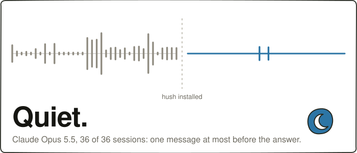

<div align="center">
  
  
  <h1>Hush</h1>
  <p><strong>Every answer in the shape you choose.</strong></p>
</div>

<p align="center"><strong>Available on</strong></p>
<table align="center">
  <tr>
    <td align="center"><a href="#install"><br />Claude Code</a></td>
  </tr>
</table>
<p align="center">Hush works in Claude Code only.</p>

<p align="center"><a href="#install"><strong>Install</strong></a> · <a href="#how-to-use-it">How to use it</a> · <a href="#does-it-work">Does it work?</a> · <a href="#learn-more">Learn more</a></p>

## What does it do?

Hush is an add-on for Claude Code, the AI assistant that writes code for you. It makes every answer short, clear and the same shape.

Without it, the answer you need gets lost among the steps.

With Hush, you get one clear message at the end: what happened, what failed, and what to do next.

<p align="center"></p>

*Ember is the mascot of the Foundry plugins. The scene is an illustration, not a measurement.*

**You ask:** "The login test fails. Fix it."

**You get:** one message, like this:

```text
**The login test passes again. The token check compared text with a number.**

---

`verifyToken` read the expiry as text, so every token looked expired.
I changed one line, auth.js:58, to read it as a number.

`npm test` passes: 212 passed, 0 failed, 0 skipped.
I did not try a real login in the browser.

---

**Next:** open auth.js:58 and read the one-line change.
```

## Install

You need Claude Code 2.1.323 or later, and Node.js 22 or later. Node.js is a free program that runs Hush's helpers; get it from [the Node.js website](https://nodejs.org).

1. Open Claude Code.
2. Type these two lines, one at a time:

   ```text
   /plugin marketplace add V-Songbird/foundry
   /plugin install hush@foundry
   ```

3. Start a new session.

To check that it worked, type `/hush:config`. Hush asks how you want your answers shaped.

To get a new version, follow [Update](docs/knowledge/install.md#update).

## How to use it

- **Do nothing.** Hush works on its own from the next session.
- **`/hush:config`** lets you pick how much you read, from `minimal` to `explainer`.
- **`/hush:config only the result and the next step`** sets it in your own words.
- **Say "explain this in depth"** to get one long answer when you need it.
- **Send `hush off`** to pause it for this session, and `hush on` to bring it back.

Most people never change a setting. No setting removes a blocker, a pending approval, an unverified claim or anything left unchecked. [Hush settings](docs/knowledge/settings.md) lists all of them.

## Does it work?

In recorded test sessions on September 28, 2026, Claude Opus 5.5 did nine coding jobs four times each, with and without Hush. Both setups got all 36 jobs right. With Hush, the assistant stayed quiet until the answer in 34 of 36 sessions, against 12 of 36 without it. That older Hush asked for silence while working. Today's Hush does not, so expect short progress notes; the desktop app folds them away.

<p align="center"></p>

**Hush cost more.** The average bill per session was 8% higher. The current Hush is not measured yet. Results vary between runs.

[Hush benchmarks](docs/knowledge/benchmarks.md) has every batch, the method and every place Hush loses.

## Good to know

- **Short can skip a detail.** Ask for more when you need it, and check the result before you act on it.
- **It does not save money.** Hush adds a little text to every request.
- **The shape is asked for, not forced.** The assistant follows it most of the time, not always.
- **It takes the one style slot.** To use another output style, turn Hush off.

[Hush limits](docs/knowledge/limits.md) lists every limit in full.

## Learn more

[How Hush works](docs/knowledge/how-it-works.md) · [Install and update](docs/knowledge/install.md) · [Hush settings](docs/knowledge/settings.md) · [Hush limits](docs/knowledge/limits.md) · [Hush benchmarks](docs/knowledge/benchmarks.md)

Release notes are on the [Hush releases page](https://github.com/V-Songbird/hush/releases). Report a bug on [Hush's issue tracker](https://github.com/V-Songbird/hush/issues), a vulnerability as [SECURITY.md](SECURITY.md) says. To change Hush, read [CONTRIBUTING.md](CONTRIBUTING.md). [Foundry](https://github.com/V-Songbird/foundry) lists the whole family.

## License

MIT, see [LICENSE](LICENSE).
