# Hush benchmarks

This page holds every measurement Hush publishes, with its method and its limits. The README shows the first batch only, under [The numbers](../../README.md#the-numbers).

All results are from Claude Code. Results vary between runs, and none of them promises the same behavior in your sessions. Each batch names the release whose voice it measured. The current voice has no measured result.

Both batches measured a voice that asked the assistant to write nothing between tool calls, with reminders that repeated it. The current voice does not ask for that. So the columns "Spoke at most once before the answer" and the words of play-by-play describe those releases, not this one. [The silence request](#the-silence-request) says why it was removed.

## Contents

- [How a session is measured](#how-a-session-is-measured)
- [Claude Opus 5.5, voice 1.13.0](#claude-opus-55-voice-1130)
- [Claude Opus 5, September 1, 2026](#claude-opus-5-september-1-2026)
- [The silence request](#the-silence-request)
- [Next to three other plugins](#next-to-three-other-plugins)
- [Where Hush loses](#where-hush-loses)

## How a session is measured

- Each test session is a real Claude Code session in its own throwaway folder.
- Nine jobs span how much a session prints, from a plan with no edits to a 300 KB outage log.
- Every job ends with a check. A short answer that breaks the job counts as a failure.
- Prices are the bill read back from the API.
- The costs of the September 28 and November 17, 2026 batches were corrected on November 23, 2026. The first published figures added up the running total of each multi-call session, so they ran about 1.7 times too high.
- Prose words exclude fenced code.

The raw records, the definitions behind these figures and the benchmark harness are kept outside this repository. They are not distributed with the plugin.

## Claude Opus 5.5, voice 1.13.0

Batch `o55-451-495ce18f`, started September 28, 2026: nine fixture jobs, four runs per setup, 36 sessions each, in Claude Code with Claude Opus 5.5 (model id `claude-opus-5-5`) at the default effort. Hush ran with `HUSH_WRAP=1`, set in bash as `HUSH_WRAP=1 claude` and in PowerShell as `$env:HUSH_WRAP = '1'; claude`. This measures the voice of release [1.13.0](https://github.com/V-Songbird/hush/releases/tag/v1.13.0).

<!-- foundry:evidence {"platform":"Claude","status":"measured","models":["Claude Opus 5.5"],"date":"2026-09-28","reviewedAt":"2026-11-14"} -->
| Model | Setup | Jobs right | Spoke at most once before the answer | Median final prose words | Average bill per session |
| --- | --- | --- | --- | --- | --- |
| Claude Opus 5.5 | No plugin | 36/36 | 28/36 | 369 | $0.255 |
| Claude Opus 5.5 | hush | 36/36 | 36/36 | 271 | $0.275 |

<p align="center"></p>

<details>
<summary>Watch the recorded demo: one real session each on Claude Opus 5.5, paced by each session's recorded time</summary>

<p align="center"></p>

</details>

Hush said nothing at all before the answer in 34 of 36 sessions, against 12 of 36 without a plugin, and sent 1.0 word of play-by-play per session against 15.4. The medians are 369 and 270.5, rounded, about 27% shorter. Sentences were shorter too: 0.5% ran past 20 words against 10.9%. Runnable content appeared in all 36 answers of both setups; that text heuristic does not check that a command is correct or complete.

**On Opus 5.5, Hush costs more.** The average bill per session was 8% higher. Seven of the nine jobs cost more, by 9% to 32%, and three of those are above about 16%, the largest gap that batch showed between two near-identical setups. Only the two jobs whose commands print the most came out cheaper: the 57 KB log by 19% and the 380 commits by 4%. Opus 5.5 already writes less without a plugin, so Hush has less to remove. Everything the assistant wrote per session was 6% higher, 3,654 tokens against 3,453, while what the commands printed fell 9%, 22.2k characters against 24.4k. Treat a per-job cost difference under about 16% in this batch as noise.

Most of that gap is the voice's own text, which rides in every request. Both setups made about seven requests per session. The tokens sent across them were 11% higher with Hush, 184,489 against 166,730. That is about 2,500 more per request. The batch ran a 5.8 KB voice. Today's voice is 7.3 KB in the desktop app. A terminal session or `claude -p` carries 5.4 KB of it; [the app part](how-it-works.md#the-app-part) says why.

**The shorter voice of Hush 2.9.0 costs about 10% less than 2.8.1.** The batch ran on 2026-11-23 with Claude Code 2.1.330, Sonnet 5.5 and the desktop entrypoint: nine jobs, four runs each, 36 sessions per setup. The mean bill was 0.1563 USD against 0.1747, and the 95% interval of that ratio is 0.828 to 0.985. Both versions passed 36 of 36. The shorter voice still cost 10.7% more than no plugin, at 0.1412 USD. It ran before a one-line format fix that 2.9.0 also carries.

Hush's gain is partly separate from length. In three jobs, the red test suite, the notification router and the half-done rename, Hush wrote more prose words on average, and in the first two every Hush session was longer than every no-plugin session. Hush messages still held 52.3% of their words in blocks over 40 words on average, against 78.3% without a plugin.

A fresh Claude Sonnet session that got only the request and the final message answered all three questions (what happened, what to open or run, what to do next) for 100% of Hush answers and 94.4% of no-plugin answers; the two no-plugin misses came from the notification router job. This test moves a few points between runs on its own. A message linked the file to open with a line number in 29 of 36 Hush sessions and none of 36 without a plugin.

## Claude Opus 5, September 1, 2026

Batch `rivalA-762f888b`, started September 1, 2026 at 07:34 UTC: nine jobs, four runs per setup, 36 sessions each, in Claude Code with the `opus` alias (the records store the alias, not a model id; it is taken to be Opus 5) at medium effort, `HUSH_WRAP=1`. The hush sessions ran hush [1.11.1](https://github.com/V-Songbird/hush/releases/tag/v1.11.1); the records do not store a version, so that is the release this batch is taken to measure.

<!-- foundry:evidence {"platform":"Claude","status":"measured","models":["Claude Opus 5"],"date":"2026-09-01","reviewedAt":"2026-11-14"} -->
| Claude Opus 5, 36 sessions each | Jobs right | Spoke at most once before the answer | Median final prose words | Sentences over 20 words | Words in blocks over 40 words, mean |
| --- | --- | --- | --- | --- | --- |
| No plugin | 36/36 | 14/36 | 367 | 19.2% | 67.8% |
| hush | 36/36 | 36/36 | 69 | 0.3% | 5.8% |

<p align="center"></p>

<details>
<summary>Watch the recorded demo from this batch: one real session each on Claude Opus 5</summary>

<p align="center"></p>

</details>

That batch does not separate structure from length: Hush's range of words per session overlapped the no-plugin range in none of the nine jobs, so every difference is also a length difference. Hush was cheaper on six of the nine jobs, by 13% to 37%, but cost more on the three quietest jobs, by 1%, 4% and 10%. A per-job cost difference under about 15% in that batch is noise: two identical setups differed by 14%, $0.4765 against $0.4112, 36 sessions each. Runnable content appeared in 34 of 36 Hush answers, 94%, and in all 36 without a plugin; the two Hush answers without it came from the red test suite and the notification router, one session each.

## The silence request

Until release 2.6.6 the voice asked for silence between tool calls, and two reminders repeated the request. A batch on November 17, 2026 compared Hush 2.6.6 with a copy that had neither the request nor the reminders: nine jobs, four runs per setup, 36 sessions each, through the Agent SDK with Claude Sonnet 5.5 (model id `claude-sonnet-5-5`).

| Setup | Jobs right | Words before the answer, mean | Average bill per session |
| --- | --- | --- | --- |
| Hush 2.6.6 | 35/36 | 4 | $0.0943 |
| The same without the silence request | 36/36 | 4 | $0.0970 |

Paired by job, the copy without the request cost $0.0027 more per session, give or take $0.0054, and wrote 149 more output tokens, give or take 246. Both differences sit inside their spread. On that model the request had no measured effect, so it was removed.

This is one model. No batch measured the removal on Claude Opus or a larger model. The removed reminders were written for those models, so expect more progress notes there.

## Next to three other plugins

Three other plugins also shape how Claude Code writes. The batches of November 17, 2026 ran each one on the same nine jobs as Hush 2.6.6, through the Agent SDK with Claude Sonnet 5.5 (model id `claude-sonnet-5-5`). Each plugin ran from a local clone, and its hook text reached every one of its sessions.

- Chisle, at commit `cf0b24f`.
- [caveman](https://github.com/JuliusBrussee/caveman), at commit `ec83e5b` of August 4, 2026.
- [i-have-adhd](https://github.com/ayghri/i-have-adhd) 0.1.0, at commit `2d19ad2`, with its always-on switch set.

Hush is the most expensive setup in both groups. It is not the one that gets the most jobs right.

| Setup, 36 sessions each | Jobs right | Average bill per session | Output tokens per session |
| --- | --- | --- | --- |
| No plugin | 33/36 | $0.0794 | 2,797 |
| Chisle | 32/36 | $0.0727 | 2,369 |
| Hush 2.6.6 | 35/36 | $0.0943 | 2,678 |

| Setup, 27 sessions each | Jobs right | Average bill per session | Output tokens per session | Final message words, mean |
| --- | --- | --- | --- | --- |
| caveman | 24/27 | $0.0757 | 2,454 | 305 |
| i-have-adhd | 27/27 | $0.0834 | 2,546 | 262 |
| Hush 2.6.6 | 26/27 | $0.0969 | 2,687 | 236 |

Paired by job, each of the three cost less than Hush, and each gap is larger than its spread: Chisle by $0.0216, give or take $0.0078, caveman by $0.0212, give or take $0.0055, and i-have-adhd by $0.0135, give or take $0.0085. Chisle also wrote 309 fewer output tokens, give or take 302. The output-token gaps of the other two sit inside their spread. The differences in jobs right are one to three sessions, too few to rank the setups.

What Hush buys with that bill is the shape of the final message. These are counts over the text of each final message, by fixed rules:

| Final message | Hush 2.6.6 | i-have-adhd | caveman | Chisle | No plugin |
| --- | --- | --- | --- | --- | --- |
| Opens with the result | 100% | 37% | 19% | 11% to 22% | 11% to 22% |
| Ends on a line that names the next step | 100% | 67% | 0% | 0% | 0% |
| Names a file as a link you can click | 85% to 96% | 0% | 0% | 0% | 0% |

Hush, Chisle and the no-plugin setup ran in two groups, so their cells give the range across both. Hush's final message was also the shortest in both groups, at 228 to 236 words on average.

### The same job, two answers

One pair, picked by rule and not by taste: the first run of the dependency-bump job in the 27-session group, Hush and i-have-adhd. Both sessions passed the job's check. Each answer is shown whole.

Hush 2.6.6, 223 words, $0.063:

````markdown
**The build passes again. Two real bugs from the bump are fixed, and 8 warnings remain.**

---

The new bundler changed two things your code relied on. It renamed the option `retries` to `retryCount`. It also leaves unset flags as `undefined` instead of `false`.

### Fixed

- [options.js:7](src/core/options.js:7) now reads `options.retryCount`. Before, `options.retries` was undefined and the link step threw.
- [retryPolicy.js:8](src/net/retryPolicy.js:8) now treats an unset `backoffEnabled` as `false`. That matches the old loader's default.

`node build.js` exits 0 and prints `build finished in 44.9s with 8 warnings, 0 errors`. It prints no tests, and I found none in the folder.

### Warnings left alone

Three look worth a look. I did not touch them, and I could not see the source behind them:

- `W3307` circular import between `src/core/graph.js` and `src/state/tracker.js`, with an undefined resolution order. This is the likeliest second real problem.
- `W1042` `crypto.createCipher` in `src/legacy/adapter.js`, to be removed before v5.
- `W2213` unused export `formatLegacyDate` in `src/utils/format.js`.

The other five are Node deprecation notices, such as `fs.exists` and `Buffer()`. They are noise for now.

Only the two files above exist in this folder. Those three warnings point at files I never saw.

---

**Next:** open the project that holds `src/core/graph.js` and break the circular import with `src/state/tracker.js`. Then say if you want me to take the other two warnings.
````

i-have-adhd 0.1.0, 183 words, $0.046:

````markdown
Build passes now (exit 0, 0 errors). The warnings are still there; none of them were the real problem.

The two real bugs were hidden in the link stage, both from the bump:

1. `src/core/options.js:7`: the bundler renamed `retries` to `retryCount`, so `options.retries` was `undefined` and threw. I switched it to `options.retryCount`.
2. `src/net/retryPolicy.js:8`: the new config loader leaves unset flags as `undefined` instead of `false`, and the strict check threw on that. `undefined` now counts as `false`, which matches the old behavior.

One thing to check: backoff now resolves to **disabled** when the flag is unset. If you want it on by default, change that line to return `true` for `undefined`.

I didn't touch the remaining warnings. Two of them look like real risks, not noise:
- `W1042`: `crypto.createCipher` in `src/legacy/adapter.js`. It's flagged for removal before v5 and is insecure.
- `W3307`: a circular import between `src/core/graph.js` and `src/state/tracker.js`, with undefined resolution order.

The rest are deprecation notices and an unused export.

Next: say "clean the warnings" and I'll start with `W1042`. That's about 15 minutes, depending on how `adapter.js` is used.
````

In this pair the i-have-adhd answer is shorter and cheaper, and it names a default the reader may want to flip, which the Hush answer does not.

### What this does not show

- No reader was measured. Nothing here says which answer a person with ADHD, or anyone else, understands faster.
- It is one model, through the Agent SDK, with three or four runs per job.
- The three plugins ran at the commits named above. A later release of any of them may behave differently.
- The counts read the text of a message. They do not check that a link opens or that a next step is the right one.

## Where Hush loses

Each loss below is measured in a batch on this page. They are gathered here so none is missed.

| Loss | Batch |
| --- | --- |
| Hush cost 8% more per session on average, and more on seven of nine jobs | Claude Opus 5.5, voice 1.13.0 |
| Hush wrote more prose words on three jobs: the red test suite, the notification router and the half-done rename | Claude Opus 5.5, voice 1.13.0 |
| Hush cost more on the three quietest jobs, by 1%, 4% and 10% | Claude Opus 5, voice 1.11.1 |
| Runnable content appeared in 34 of 36 Hush answers, against all 36 without a plugin | Claude Opus 5, voice 1.11.1 |
| Hush cost 19% more per session than no plugin, and 16% to 30% more than each of three other plugins | Claude Sonnet 5.5, Hush 2.6.6 |
| i-have-adhd got 27 of 27 jobs right, against 26 of 27 for Hush | Claude Sonnet 5.5, Hush 2.6.6 |
| Chisle wrote 309 fewer output tokens per session than Hush, give or take 302 | Claude Sonnet 5.5, Hush 2.6.6 |
