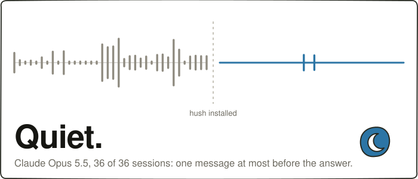
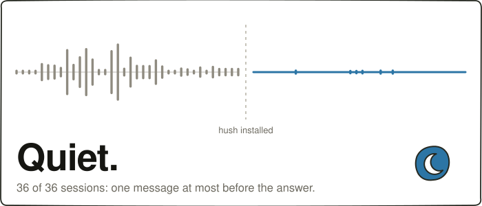

# Hush benchmarks

This page holds every measurement Hush publishes, with its method and its limits. The README shows the first batch only, under [The numbers](../../README.md#the-numbers).

All results are from Claude Code. Results vary between runs, and none of them promises the same behavior in your sessions.

## Contents

- [How a session is measured](#how-a-session-is-measured)
- [Claude Opus 5.5, voice 1.13.0](#claude-opus-55-voice-1130)
- [Claude Opus 5.5, 40 words per block](#claude-opus-55-40-words-per-block)
- [Claude Sonnet 5.5, voice 2.0.0 build](#claude-sonnet-55-voice-200-build)
- [Claude Opus 5, September 1, 2026](#claude-opus-5-september-1-2026)
- [Claude Opus 5 and Claude Sonnet, August 30, 2026](#claude-opus-5-and-claude-sonnet-august-30-2026)
- [What the earlier figures cannot show](#what-the-earlier-figures-cannot-show)
- [Where Hush loses](#where-hush-loses)

## How a session is measured

- Each test session is a real Claude Code session in its own throwaway folder.
- Nine jobs span how much a session prints, from a plan with no edits to a 300 KB outage log.
- Every job ends with a check. A short answer that breaks the job counts as a failure.
- Prices are the bill read back from the API.
- Prose words exclude fenced code.

The raw records, the definitions behind these figures and the benchmark harness are kept outside this repository. They are not distributed with the plugin.

## Claude Opus 5.5, voice 1.13.0

Batch `o55-451-495ce18f`, started September 28, 2026: nine fixture jobs, four runs per setup, 36 sessions each, in Claude Code with Claude Opus 5.5 (model id `claude-opus-5-5`) at the default effort. Hush ran with `HUSH_WRAP=1`, set in bash as `HUSH_WRAP=1 claude` and in PowerShell as `$env:HUSH_WRAP = '1'; claude`. This measures the voice released as [1.13.0](https://github.com/V-Songbird/hush/releases/tag/v1.13.0), not the current one.

<!-- foundry:evidence {"platform":"Claude","status":"measured","models":["Claude Opus 5.5"],"date":"2026-09-28","reviewedAt":"2026-11-14"} -->
| Model | Setup | Jobs right | Spoke at most once before the answer | Median final prose words | Average bill per session |
| --- | --- | --- | --- | --- | --- |
| Claude Opus 5.5 | No plugin | 36/36 | 28/36 | 369 | $0.421 |
| Claude Opus 5.5 | hush | 36/36 | 36/36 | 271 | $0.458 |

Watch the recorded demo: one real session each on Claude Opus 5.5, paced by each session's recorded time

Hush said nothing at all before the answer in 34 of 36 sessions, against 12 of 36 without a plugin, and sent 1.0 word of play-by-play per session against 15.4. The medians are 369 and 270.5, rounded, about 27% shorter. Sentences were shorter too: 0.5% ran past 20 words against 10.9%. Runnable content appeared in all 36 answers of both setups; that text heuristic does not check that a command is correct or complete.

**On Opus 5.5, Hush costs more.** The average bill per session was 9% higher. Seven of the nine jobs cost more, by 4% to 32%, and four of those are above about 16%, the largest gap that batch showed between two near-identical setups. Only the two jobs whose commands print the most came out cheaper: the 57 KB log by 19% and the 380 commits by 4%. Opus 5.5 already writes less without a plugin, so Hush has less to remove. Everything the assistant wrote per session was 6% higher, 3,654 tokens against 3,453, while what the commands printed fell 9%, 22.2k characters against 24.4k. Treat a per-job cost difference under about 16% in this batch as noise.

Most of that gap is the voice's own text, which rides in every request. Both setups made about seven requests per session. The tokens sent across them were 11% higher with Hush, 184,489 against 166,730. That is about 2,500 more per request. The batch ran a 5.8 KB voice. Today's voice is 20.9 KB, and no batch has measured its cost. Since 2.6.0 a terminal session carries 16.7 KB of it; [the app part](how-it-works.md#the-app-part) says why.

Hush's gain is partly separate from length. In three jobs, the red test suite, the notification router and the half-done rename, Hush wrote more prose words on average, and in the first two every Hush session was longer than every no-plugin session. Hush messages still held 52.3% of their words in blocks over 40 words on average, against 78.3% without a plugin.

A fresh Claude Sonnet session that got only the request and the final message answered all three questions (what happened, what to open or run, what to do next) for 100% of Hush answers and 94.4% of no-plugin answers; the two no-plugin misses came from the notification router job. This test moves a few points between runs on its own. A message linked the file to open with a line number in 29 of 36 Hush sessions and none of 36 without a plugin.

## Claude Opus 5.5, 40 words per block

The voice now also caps each block of the final answer at 40 words; a block is the text between two blank lines. The figures above do not measure that rule. Batch `o55-888-1bec0539`, started September 28, 2026: the same nine jobs, four runs per setup, 36 sessions each, Claude Opus 5.5, default effort, `HUSH_WRAP=1`, with no no-plugin setup. It compares the [1.13.0](https://github.com/V-Songbird/hush/releases/tag/v1.13.0) build with the same build plus the block rule.

<!-- foundry:evidence {"platform":"Claude","status":"measured","models":["Claude Opus 5.5"],"date":"2026-09-28","reviewedAt":"2026-11-14"} -->
| Claude Opus 5.5, 36 sessions each | hush 1.13.0 | hush with the block rule |
| --- | --- | --- |
| Jobs right | 36/36 | 36/36 |
| Median final prose words | 283 | 256 |
| Words in blocks over 40 words, mean | 59.1% | 45.3% |
| Words in blocks over 40 words, median | 62.3% | 50.0% |
| Notes that link the file with a line number | 27/36 | 29/36 |
| A fresh reader could answer all three questions | 100% | 100% |
| Everything Claude writes in a session | 3,938 tok | 3,490 tok |
| Average bill per session | $0.461 | $0.452 |

The rule cut the share of words in long blocks by 13.8 points, in 7 of the 9 jobs (exact two-sided sign-flip p 0.016), and cost no correctness. The cost difference is within this batch's noise: per job it ranged from 23% cheaper on the half-done rename to 31% dearer on the release notes. Compare these two setups only with each other; the same 1.13.0 voice held 52.3% of its words in long blocks in the first batch and 59.1% here, and the two batches ran different tool-output compression.

## Claude Sonnet 5.5, voice 2.0.0 build

Batch `b31-quiet-0c14009e`, started October 13, 2026, in Claude Code with Claude Sonnet 5.5 (model id `claude-sonnet-5-5`) at the default effort: two runs of eleven jobs per setup, 22 sessions each, shuffled inside each job and repetition. Hush ran with `HUSH_WRAP=1` from a build whose manifest read [2.0.0](https://github.com/V-Songbird/hush/releases/tag/v2.0.0); it also carried part of the voice a later release shipped. The eleven jobs are the nine above plus a listing of 167 locale files and the three bad rows in a 151-line stretch of a 1,600-row CSV file. Compare these figures only with each other: the same build's bill per session has moved by about 5% between batches.

<!-- foundry:evidence {"platform":"Claude","status":"measured","models":["Claude Sonnet 5.5"],"date":"2026-10-13","reviewedAt":"2026-11-14"} -->
| Claude Sonnet 5.5, 22 sessions each | no plugin | hush |
| --- | --- | --- |
| Jobs right | 20/22 | 22/22 |
| Spoke at most once before the answer | 17/22 | 22/22 |
| Said nothing at all | 14/22 | 21/22 |
| Total mid-work messages | 14 | 1 |
| Words of play-by-play, per session | 10.2 | 1.1 |
| Median final prose words | 293 | 231 |
| Sentences over 12 words | 32.8% | 15.8% |
| Words in blocks over 40 words, mean | 74.1% | 46.8% |
| Average bill per session | $0.164 | $0.174 |

Both no-plugin misses came from the `--json` flag plan: Claude planned without reading the code, and neither plan named the files the job's check needs. Hush still wrote about one sentence in six over its own 12-word limit, and kept almost half of each message in blocks over 40 words. Hush cost 6% more per session, and two sessions per job are too few to tell a difference that size from noise.

Each job has a fixed answer key of required facts, matched by code or judged by a Claude Sonnet session that must quote its source. Nine jobs have a key; the two new jobs have none, and the notification router is left out because its facts arrive in later prompts. Over 8 jobs and 16 sessions each, Hush carried 88.8% of required facts against 79.2%, and 11 of 16 sessions carried every fact against 10 of 16. The gap comes from one job: the two no-plugin `--json` plans carried none of its facts. Over the other seven jobs, no plugin carried 90.5% and Hush 87.1%. Hush carried more on 2 of the 8 jobs and less on 2 (p 0.875).

## Claude Opus 5, September 1, 2026

Batch `rivalA-762f888b`, started September 1, 2026 at 07:34 UTC: nine jobs, four runs per setup, 36 sessions each, in Claude Code with the `opus` alias (the records store the alias, not a model id; it is taken to be Opus 5) at medium effort, `HUSH_WRAP=1`. The hush sessions ran hush [1.11.1](https://github.com/V-Songbird/hush/releases/tag/v1.11.1), the release current when the batch started; the records do not store a version. This is an earlier voice than the one measured above.

<!-- foundry:evidence {"platform":"Claude","status":"measured","models":["Claude Opus 5"],"date":"2026-09-01","reviewedAt":"2026-11-14"} -->
| Claude Opus 5, 36 sessions each | Jobs right | Spoke at most once before the answer | Median final prose words | Sentences over 20 words | Words in blocks over 40 words, mean |
| --- | --- | --- | --- | --- | --- |
| No plugin | 36/36 | 14/36 | 367 | 19.2% | 67.8% |
| hush | 36/36 | 36/36 | 69 | 0.3% | 5.8% |

Watch the recorded demo from this batch: one real session each on Claude Opus 5

That batch does not separate structure from length: Hush's range of words per session overlapped the no-plugin range in none of the nine jobs, so every difference is also a length difference. Hush was cheaper on six of the nine jobs, by 13% to 37%, but cost more on the three quietest jobs, by 1%, 4% and 10%. A per-job cost difference under about 15% in that batch is noise: two identical setups differed by 14%, $0.4765 against $0.4112, 36 sessions each. Runnable content appeared in 34 of 36 Hush answers, 94%, and in all 36 without a plugin; the two Hush answers without it came from the red test suite and the notification router, one session each.

## Claude Opus 5 and Claude Sonnet, August 30, 2026

Two batches, both in Claude Code with `HUSH_WRAP=1` and an earlier voice. They recorded no explicit effort, so the effective default is unknown, and the hush version is not stated. `rm320-99a236ff`, started 02:53 UTC with the recorded `opus` alias (Opus 5): 36 sessions per setup. `sn320-a9885078`, started 03:30 UTC with `sonnet`: 18 sessions per setup. Both setups got every job right in both batches (36/36 on Opus 5, 18/18 on Sonnet).

<!-- foundry:evidence {"platform":"Claude","status":"measured","models":["Claude Opus 5","Claude Sonnet"],"date":"2026-08-30","reviewedAt":"2026-11-14"} -->
| Setup | Opus 5, spoke at most once | Opus 5, said nothing at all | Opus 5, words of play-by-play per session | Sonnet, spoke at most once | Sonnet, said nothing at all | Sonnet, words of play-by-play per session |
| --- | --- | --- | --- | --- | --- | --- |
| No plugin | 12/36 | 0/36 | 41.1 | 12/18 | 5/18 | 30.1 |
| hush | 36/36 | 28/36 | 1.5 | 16/18 | 11/18 | 8.1 |

The fully silent count is the softer measure: it slides with session length, near 100% on short jobs and lower on the longest, and the at-most-once result is not a guarantee for other workloads. On Opus 5, Hush cut what the commands printed by 28% (23.1k characters against 16.5k per session) and everything Claude wrote by 40% (4,442 tokens against 7,365).

Cost by job swung. On Opus 5, Hush cost less on 7 of 9 jobs, by 8% to 41%, and 1% and 4% more on the other two. On Sonnet it cost 7% to 8% more on four jobs (the `--json` plan, the red test suite, the dependency bump and the half-done rename) and 31% more on the notification router, and saved 39% and 41% on the two jobs that print most. This harness has read anywhere from -15% to +4% overall across runs, so Hush states no suite-wide cost figure.

A fresh Claude Sonnet reader answered all three questions for 97.2% of answers with and without Hush on Opus 5, a tie: one Hush reply in 36 did not say plainly enough what had happened. On Sonnet, 100% against 83.3%. That test moves a few points between runs. A note linked the file with a line number in 81% of Hush sessions on Opus 5 and 44% on Sonnet; none of the 54 no-plugin sessions produced a clickable file link.

## What the earlier figures cannot show

Every earlier-voice figure was measured before output under 4,000 characters stopped being folded by shape or cut by line count, and before listings, line-range prints, diffs, whole source reads and clean JSON came back whole. Replaying recorded no-plugin tool output offline through the compression with and without the 4,000-character floor, Hush prints 2.8% more per session in the September 1 batch, 1.8% more in the August 30 Opus batch and 0.1% more in the Sonnet one, averaged over nine jobs. Two later changes add to the September 1 batch only: whole source reads, +0.4%, and listings or diffs piped into a line-range print, +1.1%. The replay counts characters only: no price was re-measured, and it cannot show the re-runs the floor exists to prevent.

## Where Hush loses

Each loss below is measured in a batch above. They are gathered here so none is missed.

| Loss | Batch |
| --- | --- |
| Hush cost 9% more per session on average, and more on seven of nine jobs | Claude Opus 5.5, voice 1.13.0 |
| Hush wrote more prose words on three jobs: the red test suite, the notification router and the half-done rename | Claude Opus 5.5, voice 1.13.0 |
| Hush cost 6% more per session, a difference too small to tell from noise with two sessions per job | Claude Sonnet 5.5, voice 2.0.0 build |
| Hush still wrote about one sentence in six over its own 12-word limit | Claude Sonnet 5.5, voice 2.0.0 build |
| Over seven of the eight keyed jobs, Hush carried 87.1% of required facts against 90.5% without a plugin | Claude Sonnet 5.5, voice 2.0.0 build |
| Hush cost more on the three quietest jobs, by 1%, 4% and 10% | Claude Opus 5, September 1, 2026 |
| Runnable content appeared in 34 of 36 Hush answers, against all 36 without a plugin | Claude Opus 5, September 1, 2026 |
| On Sonnet, Hush cost 7% to 8% more on four jobs and 31% more on the notification router | August 30, 2026 |
